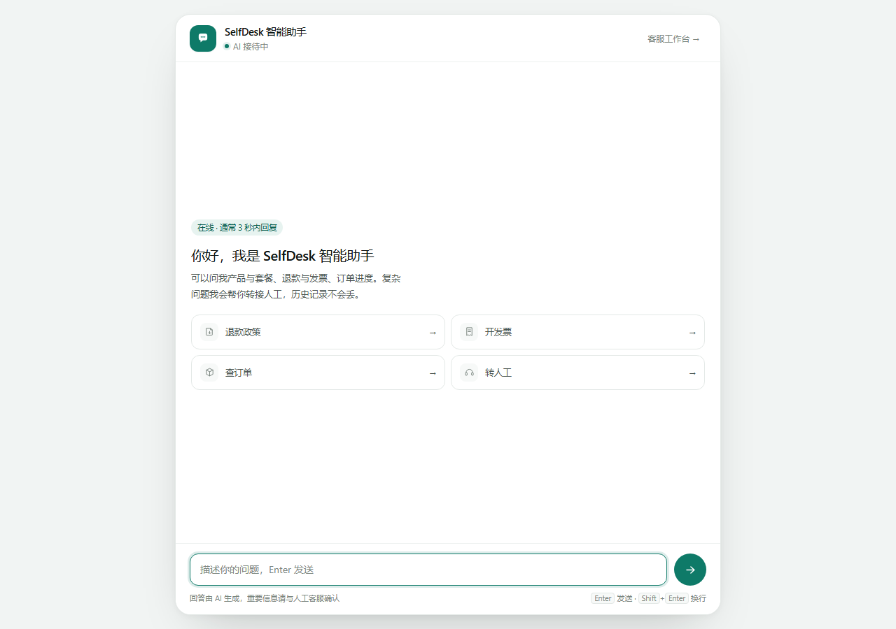
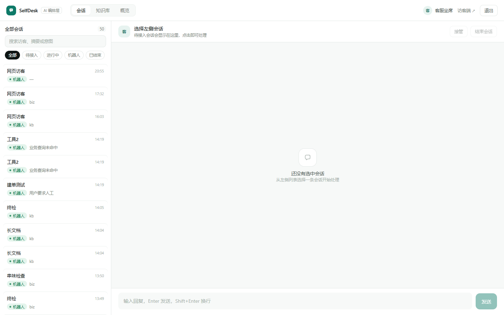
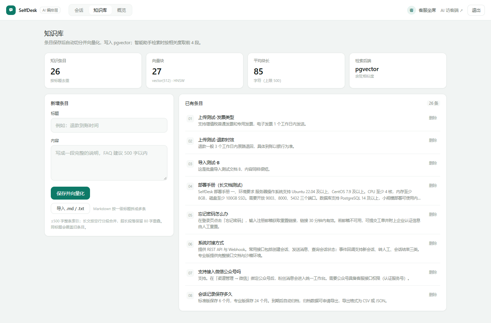
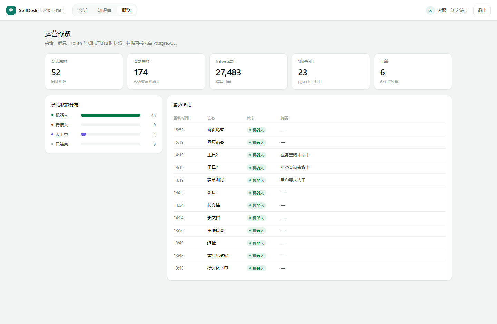

# SelfDesk · LangGraph 智能客服编排层


[English](README.en.md) · 简体中文

把客服 AI 从业务系统里剥出来，做成一个**可独立运行的图编排服务**：意图分流 → 检索增强 → 工具调用 → 两阶段写操作 → 转人工挂起/恢复。


> 想先跑起来 → [快速开始](#快速开始)；想看设计取舍 → [核心设计](#核心设计)。

不是「套一层 prompt 的聊天框」：每一步都有明确状态、可回放的 checkpoint，以及可查的证据（意图、命中片段、工具调用、延迟、token）。



---

## 目录

- [为什么值得看](#为什么值得看)
- [架构](#架构)
- [核心设计](#核心设计)
- [功能](#功能)
- [快速开始](#快速开始)
- [配置](#配置)
- [HTTP 接口](#http-接口)
- [业务工具](#业务工具)
- [目录结构](#目录结构)
- [验证状态](#验证状态)
- [测试](#测试)
- [已知限制](#已知限制)

---

## 为什么值得看

| 常见做法 | 这里的做法 |
|---|---|
| 所有问题丢给模型自由发挥 | 先做意图分流：知识问答走 RAG、业务查询走工具、明确要人工才转接 |
| 让模型直接「帮用户下单/退款」 | **两阶段确认**：先返回提案，用户确认后才执行，带幂等键 |
| 转人工 = 前端弹个提示 | `interrupt` 真挂起，状态写进 checkpoint，进程重启也不丢 |
| 向量库、业务库、会话状态三套存储 | 全部放 PostgreSQL：业务表 + pgvector + checkpoint 同库 |
| 换语言重写就接不进业务 | 提供 OpenAI 兼容 `/v1/chat/completions`，Java Spring AI 改个 base-url 即可接入 |

## 架构

```
       访客端 (8003 /)                     AI 工作台 (8003 /console)
             │  POST /api/chat                      │
             ▼                                      ▼
        ┌──────────────────── FastAPI ────────────────────┐
        │                                                │
        │   LangGraph 状态图                              │
        │   ├─ classify   知识 / 业务 / 人工              │
        │   ├─ retrieve   pgvector 检索（bge-small-zh）   │
        │   ├─ tool       9 个业务工具，写操作走两阶段     │
        │   ├─ handoff    interrupt 挂起，等坐席 resume   │
        │   └─ answer     模型生成 + 引用来源             │
        │                                                │
        └───────┬──────────────────┬─────────────────────┘
                │                  │
     PostgreSQL 16 + pgvector     本地 Embedding (:8000)
     业务表 / 知识库 / checkpoint   fastembed · 512 维
```

## 核心设计

### 1. 意图先分流，不让模型自由发挥

`classify` 节点用规则把问题分成三类，后面的路径完全不同：

- **知识类**（退款政策、发票、用量）→ 检索 + 生成，附带引用片段
- **业务类**（查订单、退款进度、建工单、下单）→ 调工具，模型只负责组织语言
- **人工类**（投诉、明确要求转人工、检索分数过低）→ 挂起等人

好处是可测试、可预测：同一句话永远走同一条路径，不会今天答 A 明天答 B。

### 2. 两阶段写操作

模型不能直接动数据。下单/退款/建工单都是：

```
用户：帮我下单标准版
AI：  待确认 — 标准版月付 ¥129，确认后创建（提案已落库）
用户：确认
AI：  已创建订单 2026xxxx（幂等键 pi_xxx，重复确认不会重复下单）
```

`execute_pending` 读取提案并落库，幂等键保证同一提案只执行一次。

### 3. 转人工是真挂起

`handoff` 节点调用 LangGraph 的 `interrupt`，图停在那一刻，状态进入 PostgreSQL checkpoint。
坐席在 8003 工作台回复时调 `resume`，图从断点继续，把坐席消息带给访客。
服务重启、进程崩溃都不影响——状态不在内存里。

### 4. 三份数据一个库

业务表（sessions / messages / tickets / orders）、向量块（kb_chunks）、图状态（checkpoints）都在同一个 PostgreSQL。
少一套依赖，事务边界清楚，备份只备一个库。

### 5. OpenAI 兼容层

`/v1/chat/completions` 支持流式，语义与 OpenAI 一致，额外带 `X-SelfDesk-Session` 头复用会话。
Java 侧只要把 Spring AI 的 `base-url` 指过来，业务代码一行不改就能用上这套编排。

## 功能

**访客侧**

- 多轮对话，刷新不丢历史（会话 ID 存 localStorage）
- 知识问答带引用，不确定就转人工，不硬编
- 订单/退款/工单查询，写操作二次确认

**坐席侧（8003/console，本机免密）**

- 会话：列表、搜索、状态筛选、接管、回复、结束
- 知识库：新增、批量导入 `.md/.txt`（Markdown 按一级标题拆多条）、删除、切分统计
- 概览：会话/消息/Token/工单，状态分布

**运营指标**

- 每条回复记录意图、命中片段、工具调用、延迟、token
- `/api/dashboard` 汇总；`/api/health` 暴露 DB、pgvector、checkpoint 状态

## 快速开始

前置：

- Python 3.11+（实测 3.13）
- PostgreSQL 14+ 且安装 `pgvector` 扩展
- 一个 DeepSeek API Key（或任何 OpenAI 兼容端点）

### 方式 A：Windows + WSL（本机开发用）

```powershell
cd selfdesk-langgraph
python -m venv .venv
.\.venv\Scripts\pip install -r requirements.txt
copy .env.example .env      # 填 DEEPSEEK_API_KEY
.\start.ps1
```

脚本会依次拉起 PostgreSQL（WSL）、Embedding（:8000）、主服务（:8003），并打开访客端与工作台。

首次使用灌一份演示知识库：

```powershell
.\.venv\Scripts\python seed_kb.py
```

### 方式 B：任意平台（Docker）

```bash
docker compose up -d                # PostgreSQL + pgvector
python -m venv .venv && source .venv/bin/activate   # Windows: .venv\Scripts\activate
pip install -r requirements.txt
cp .env.example .env                # 填 DEEPSEEK_API_KEY

python -m uvicorn embedding_server:app --host 127.0.0.1 --port 8000 &
python run.py                       # 主服务 :8003
```

打开 http://127.0.0.1:8003/ 和 http://127.0.0.1:8003/console

> 工作台默认账号 `agent@selfdesk.local` / `SelfDesk#2026`。本机访问时 `/api/auth/local` 会自动签发令牌，不用输密码；远程访问需登录。







## 配置

全部通过环境变量，代码里没有硬编码密钥。

| 变量 | 默认 | 说明 |
|---|---|---|
| `DEEPSEEK_API_KEY` | — | 必填；也可放项目根 `.deepseek-key` |
| `SELFDESK_KEY_FILE` | — | 额外的密钥文件路径 |
| `LLM_BASE_URL` | `https://api.deepseek.com/v1` | 任何 OpenAI 兼容端点 |
| `LLM_MODEL` | `deepseek-chat` | 模型名 |
| `LLM_TEMPERATURE` | `0.3` | 生成温度 |
| `SELFDESK_PG_DSN` | `host=127.0.0.1 port=5432 dbname=selfdesk user=selfdesk password=selfdesk_local` | 整体覆盖连接串 |
| `EMBEDDING_URL` | `http://127.0.0.1:8000/v1/embeddings` | 向量服务 |
| `EMBEDDING_MODEL` | `BAAI/bge-small-zh-v1.5` | 512 维，中文短文本够用且快 |
| `EMBEDDING_DIM` | `512` | 必须与模型一致 |

## HTTP 接口

| 方法 | 路径 | 说明 |
|---|---|---|
| POST | `/api/sessions` | 新建会话 |
| POST | `/api/chat` | 发消息，返回回答/转人工状态 |
| GET | `/api/sessions/{id}` | 会话详情与消息 |
| POST | `/api/auth/login` | 坐席登录 |
| GET | `/api/auth/local` | 本机免密（仅回环地址） |
| GET | `/api/console/sessions` | 坐席侧会话列表 |
| POST | `/api/console/claim` | 接管会话 |
| POST | `/api/console/reply` | 坐席回复（唤醒挂起的图） |
| POST | `/api/console/close` | 结束会话 |
| POST/GET | `/api/kb/docs` | 新增 / 列出知识条目 |
| POST | `/api/kb/import` | 批量导入（≤50 篇，逐篇返回失败原因） |
| DELETE | `/api/kb/docs/{id}` | 删除条目（级联删向量块） |
| GET | `/api/dashboard` | 运营概览 |
| POST | `/v1/chat/completions` | OpenAI 兼容（支持流式） |

## 业务工具

| 工具 | 作用 | 写操作 |
|---|---|---|
| `query_order` | 按订单号查详情与物流 | 否 |
| `query_refund` | 查退款进度 | 否 |
| `business_info` | 营业时间/电话/地址 | 否 |
| `query_ticket` | 查本会话工单 | 否 |
| `account_info` | 账号与套餐 | 否 |
| `match_product` | 匹配产品与价格 | 否 |
| `create_ticket` | 建工单 | 是（两阶段） |
| `submit_refund` | 提交退款申请 | 是（两阶段） |
| `create_order` | 创建订单 | 是（两阶段） |

## 目录结构

```
app/
├─ api.py            FastAPI 路由、认证、知识库、工作台
├─ graph.py          LangGraph 状态图（classify/retrieve/tool/handoff/answer）
├─ tools.py          业务工具 + 两阶段执行
├─ rag.py            切分与检索
├─ pg_store.py       知识库读写（pgvector）
├─ pg.py             连接池与健康检查
├─ db.py             会话/消息/工单/订单
├─ openai_compat.py  OpenAI 兼容层（含流式）
├─ config.py         集中配置
├─ static/           访客端与工作台页面
└─ auth.py           令牌签发与校验（可脱离数据库单测）
tests/               单元测试（pytest）
seed_kb.py           演示知识库
reindex_kb.py        重建索引（换模型/调切分参数时用）
embedding_server.py  本地向量服务（fastembed）
```

## 验证状态

不是「应该能跑」：用全新 venv 从零安装依赖，把完整链路跑了一遍。

| 验证项 | 结果 |
|---|---|
| `pip install -r requirements.txt`（全新 venv） | 通过 |
| `/api/health` | `db=postgres`、`kbBackend=pgvector`、`checkpoint=postgres` |
| 知识问答 | 命中 2 个片段（0.69 / 0.64），2.5 秒返回 |
| 工具调用 | `query_order` 正确返回订单、金额、物流 |
| 转人工 | 落为 `WAITING_AGENT`，工作台列表可见 |
| 坐席接管 + 回复 | 访客端收到人工消息，状态变 `AGENT`（checkpoint 恢复成功） |
| 两阶段写操作 | 提案 → 「确认」→ 创建订单并返回单号 |
| 自带向量服务 | `/health` 与 `/v1/embeddings` 正常返回 512 维向量 |
| 静态页面 | `/` 与 `/console` 均 200 |
| 单元测试 | 34 passed（`pytest`） |
| CI | GitHub Actions：测试 + 密钥扫描 + 敏感文件检查 |

## 测试

```bash
pip install -r requirements-dev.txt
pytest                     # 34 个用例，约 0.5 秒，不依赖外部服务
pytest -m db               # 两阶段幂等（需要 SELFDESK_TEST_DSN 指向一个测试库）
```

| 文件 | 覆盖什么 |
|---|---|
| `tests/test_auth.py` | 令牌签发、签名被改、过期、换密钥后失效 |
| `tests/test_chunking.py` | 短文本整条、500 字上限、超长段 80 字重叠、尾块合并 |
| `tests/test_routing.py` | 意图路由（查单/退款/下单/政策问题不误触）、单号提取边界 |
| `tests/test_two_phase_db.py` | 同一提案确认两次只落一单；待确认动作流转与过期 |

CI 里还会额外跑：脚本语法、密钥扫描、敏感文件、README 图片引用。

## 已知限制

- **单 Agent、单租户**：演示够用，多租户字段已预留（`tenant_id`），但没有做隔离策略。
- **意图分类是规则**：可解释、可测试，但泛化不如小模型分类器；换行业要改规则。
- **只支持 `.md/.txt` 导入**：docx/pdf 需要额外解析，尚未实现。
- **Embedding 首次启动会下载模型**（约 100MB），之后走本地缓存。
- **工作台免密只对回环地址**：`/api/auth/local` 在远程访问时返回 403。

## License

MIT
